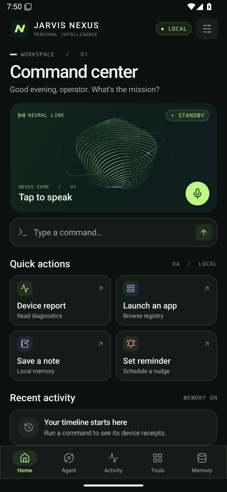
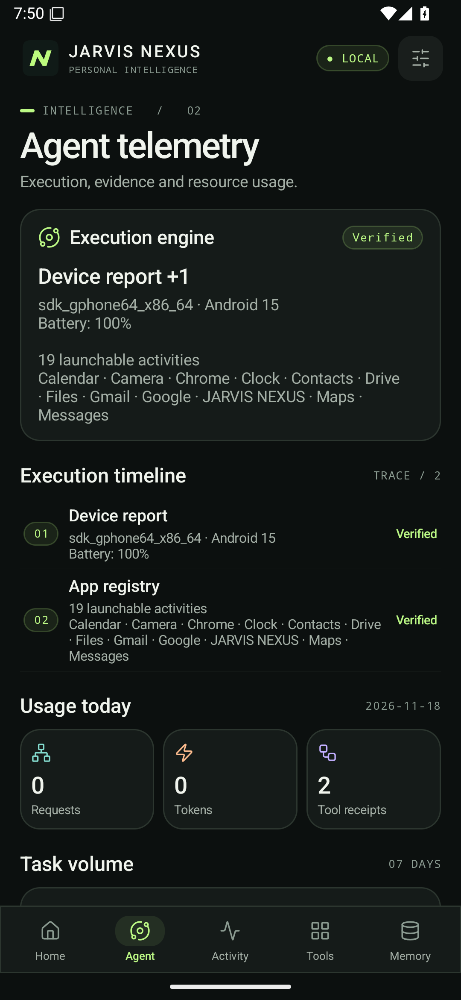

# JARVIS NEXUS

A native, Persian/English Android assistant that plans with Gemini and acts through a **closed registry of device tools**. The execution engine—not the language model—decides what was observed. “Dialer opened” is not “call connected.”

**Android 8.0+ · target SDK 36 · personal-key or managed-gateway mode · no local model or PC required.** This is a debug testing distribution, not a production-signed Play release.

**[راهنمای فارسی نصب و استفاده](docs/FA.md)** · [Debug distribution and release notes](docs/RELEASE.md) · [What passed / what remains unverified](docs/TESTING.md)

## Install and try it

1. Download **[JARVIS-NEXUS.apk](delivery/JARVIS-NEXUS.apk)**. Compare its SHA-256 with [the device evidence](docs/evidence/android/apk.sha256).
2. Open the APK on your Android phone, or run `adb install -r JARVIS-NEXUS.apk`. Only allow installation from a source you trust. Different debug builds can have different signing certificates; Android will reject an update with a different signer. Export anything you want to keep before uninstalling an incompatible older build.
3. Open **JARVIS NEXUS → Type a command**. Try **`device report then list apps`** or **`گزارش دستگاه و بعد فهرست برنامه‌ها`**. Open **Agent** to see actual OS observations. These commands need no API key.
4. For free-form planning, open the status chip or **Settings → Gemini provider**. Enter your own Gemini Developer API key, select a model and choose **Save & test function calling**. This checks model metadata **and** a nonce-bearing, harmless function call. Merely saving a key does not mark the connection verified. Never paste a key into a command, issue, note or chat.
5. Tap the voice field to start speaking. Select **فارسی** or **English** under Language. Recognition and speaking voices depend on the installed Android engines. Text is always available.

**شروع سریع:** از «مرکز فرمان» یک فرمان بنویسید یا میکروفون را لمس کنید. برای فرمان‌های آزاد، کلید شخصی را در «تنظیمات ← ارائه‌دهندهٔ جمینای» وارد و آزمایش کنید. تماس، پیام و اشتراک‌گذاری به تأیید شما نیاز دارند. برنامه هیچ تماس یا پیامی را بی‌صدا ارسال نمی‌کند.

 

## Useful commands

| Instruction | What actually happens |
|---|---|
| `جرویس، واتساپ رو باز کن.` / `Open Spotify` | Resolve launchable activities by name, aliases and fuzzy matching. Ask when a selection is needed. |
| `If Spotify is installed, open it` | Query the installed registry first; a missing match stops the sequence. |
| `برو داخل تنظیمات وای‌فای` | Open the system settings page. Does **not** toggle Wi-Fi. |
| `به مامانم زنگ بزن` | Request contacts access, resolve a number, clarify multiple matches, show the exact number, then hand off to `ACTION_DIAL` **only after approval**. |
| `به مامانم پیام بده که نیم ساعت دیگه میام` | Preview the selected recipient and literal message. The user sends in the native composer. |
| `Search YouTube for OpenJarvis` / `Route to a pharmacy` | Preview the external query and open the supported search or route interface. No unverified “nearest” claim. |
| `ساعت هفت یادآوری کن که تکالیفم رو انجام بدم` | Preview the next local 07:00 and reminder text, then schedule an **approximate** Android notification. |
| `Remember: return the library book` / `Recall note library` | Explicit local note storage with read-back; retrieve matching notes without returning their content to the model. |

Create shortcuts, pin favorite sequences, and assign app/contact aliases in **Memory**. To continue a multi-step task after leaving Nexus for another app, return to Nexus. It will not launch the next screen from the background. Pending confirmations cannot be replayed after process death.

## Build from source

Install JDK 17, Android SDK Platform 36, Android Build Tools 35.0.0 or newer, and Platform Tools. Set `ANDROID_HOME` or use Android Studio's `local.properties`. The Gradle wrapper is included (8.13; AGP 8.11.1).

```sh
./gradlew testDebugUnitTest assembleDebug assembleDebugAndroidTest
adb install -r app/build/outputs/apk/debug/app-debug.apk
adb shell am start -W -n ai.nexus/.MainActivity
```

If the SDK is already installed but Maven/Gradle distribution downloads are unavailable, the project has **no runtime library dependencies** and can also be built using the SDK tools directly:

```sh
export JAVA_HOME=/path/to/jdk-17 ANDROID_HOME=/path/to/android-sdk
scripts/sdk-build.sh       # build/sdk-debug/JARVIS-NEXUS.apk; actual debug signing and verification
scripts/test-core.sh       # pure host checks
scripts/sdk-device-tests.sh  # optional, separate test-only APK signed with the same debug key
node --test gateway/security.test.mjs   # Node 22.18+ for the optional managed gateway
```

Explicit CI capture builds use this SDK-only lane so a Maven rate limit cannot silently substitute an untested APK. Ordinary CI builds use Gradle, including the JUnit wrapper around the same host checks. The SDK application build uses only `aapt2`, `javac`, `jar`, `d8`, `zip`, `zipalign`, `keytool` and `apksigner`. It creates a conventional **debug** keystore outside the checkout if none exists. No private signing material is stored in Git. A release build is deliberately not production-signed by this project.

## Engineering and release evidence

- [Architecture and tool-extension contract](docs/ARCHITECTURE.md)
- [Feature implementation report and limitations](docs/FEATURES.md)
- [Permission and privacy explanation](docs/PERMISSIONS.md)
- [Build/test procedure, evidence and release gates](docs/TESTING.md)
- [Optional authenticated server-side Gemini gateway](gateway/README.md)
- [Release notes](docs/RELEASE.md)

The application code is under `app/src/main/java/ai/nexus/`. Native Canvas/Views, SQLite, Android Keystore, OS speech services and public intents keep the APK small. Android test fixtures are in a **separate test APK**, not the delivered application. Lucide/Feather notices are included under `app/src/main/assets/notices/`.
